<div align="center">

# Vision Incident Response Kit (VIRK)

[](https://opensource.org/licenses/MIT)
[](https://www.python.org/downloads/)
[](https://github.com/krishna-dhulipalla/Vision-Incident-Response-Kit--VIRK-)

### Production incident response and drift forensics for vision models

</div>

VIRK is a lightweight flight recorder for vision pipelines. It runs alongside inference, detects distribution drift (blur, lighting, camera shifts), attributes likely causes, and bundles reproducible incident packs for debugging.

## Architecture

<div align="center">

<a href="docs/architecture.svg">
  
</a>

</div>

## Why VIRK

- **Incident-first**: Focused on diagnosing failures, not building a full observability platform.
- **Inspectable**: Bundles sample images and diagnostic metadata for debugging an incident.
- **Actionable**: Ranks suspected causes (blur, brightness, noise) and affected slices.
- **Low friction**: Designed to sit alongside inference with minimal integration overhead.

## Key Features

- **Scalable Drift Detection**: Uses RBF MMD with subsampling. Complexity is **O(k^2)** (where k=subsample size, e.g. 1000), and O(1) relative to total stream volume N.
- **Async & Non-Blocking**: Heavy diagnostics (fingerprinting, bundling) run in a single background worker thread (default queue size=100). If the queue fills under load, new drift events are dropped (load shedding) to protect inference latency.
- **Cause Fingerprinting**: Ranks matches to known corruption signatures (e.g., motion blur or brightness shift). These are diagnostic hypotheses, not proof of causality.
- **Incident Bundler**: Automatically creates zip bundles with images, metadata, and a replay script for local reproduction.

## Installation

```bash
git clone https://github.com/krishna-dhulipalla/Vision-Incident-Response-Kit--VIRK-.git
cd Vision-Incident-Response-Kit--VIRK-
pip install -e .
```

### Optional Dependencies

- **S3 Storage**: `pip install -e .[s3]`
- **Prometheus**: `pip install -e .[prometheus]`
- **OpenTelemetry**: `pip install -e .[otel]`

## Integration Guide

### 1. The Easy Way: `VirkMiddleware.create()`

Wrap your prediction logic with our middleware. The `create()` factory uses sensible defaults.

```python
from virk.integration.middleware import VirkMiddleware

# 1. Initialize (One Line)
# Note: 'extractor' must implement .extract(List[Union[str, PIL.Image, np.ndarray]]) -> np.ndarray (EmbeddingExtractor-compatible).
monitor = VirkMiddleware.create(
    reference_embeddings=ref_data,  # Your training/baseline embeddings
    extractor=model,                 # Feature extractor (e.g. TIMM model interface)
    output_dir="/tmp/bundles",       # Where to save incidents
    metrics_type="prometheus",       # 'prometheus', 'otel', or 'none'. OTel falls back to Prom if missing, then NoOp.
    async_processing=True            # Run heavy tasks in background
)

# 2. Inside your inference loop
def predict(images):
    embeddings = model.encode(images)

    #  Hook! (Non-blocking)
    monitor.process_batch(
        embeddings=embeddings,
        image_paths=[img.path for img in images],
        metadata=[{"cam": img.cam_id} for img in images]
    )
```

### 2. Calibration (FPR Targeting)

Use `calibrate` to estimate a threshold targeting an **empirical batch false positive rate** (e.g., 5%) on held-out clean validation scores. This does **not guarantee the same false positive rate on future data**.

```bash
virk calibrate --dataset path/to/clean_data --test-dataset path/to/independent_clean_test --fpr 0.05 --batch-size 32 --num-batches 50 --seed 42 --output calibration.json
```

The command splits `--dataset` into disjoint reference and calibration sets, scores up to `--num-batches` complete calibration batches, and selects the `(1 - fpr)` quantile using the conservative `higher` rule. Incomplete trailing batches are excluded. The empirical calibration FPR is measured on the scores used to choose the threshold. With 50 batches, that rate changes in steps of 2 percentage points.

With `--test-dataset`, the threshold is frozen before scoring the separate clean test set. The report adds test FPR and a [Wilson confidence interval](https://itl.nist.gov/div898/handbook/prc/section2/prc241.htm), conditional on independent representative clean batches. Overlapping files and byte-identical copies across the input directories are rejected. Omitting `--test-dataset` produces calibration statistics only.

**Example output (values depend on the dataset):**

```text
==================================================
 VIRK THRESHOLD CALIBRATION
==================================================
Target FPR:          5.0%
Empirical FPR:       4.0%
Validation batches:  50
Max Clean Score:     0.0421
--------------------------------------------------
RECOMMENDED THRESHOLD: 0.038512
Empirical calibration only; future false positive rates may differ.
==================================================
```

Validate the selected threshold on a separate clean test split before deployment. Match the feature extractor, preprocessing, reference distribution, batch/window size, and detector settings to deployment. The CLI uses a pretrained ResNet-18 and a new reference split; its threshold is not automatically transferred to middleware. Middleware monitors a sliding window of 1000 embeddings by default, with checks starting at 25% fill; a threshold calibrated on batches of 32 is not calibrated for those window sizes. Overlapping windows and repeated checks also affect operational alert rates. Recalibrate and revalidate when the data or monitoring setup changes.

Pass a threshold validated for your window setup with `VirkMiddleware.create(..., drift_threshold=threshold)`. Set `window_size` and `min_window_size=window_size` for checks on full windows. The separate `incident_threshold` (default 0.05) controls bundle creation after drift is detected.

## Demo Service

VIRK includes a demo service with simulated embeddings. Install the demo dependencies to run it:

```bash
# Runs uvicorn with the demo app
pip install -e ".[demo,prometheus]"
virk demo-prod --port 8080
```

## Integrations

Popular library examples (optional dependencies):

- YOLOv8: `examples/yolo_integration.py`
- Hugging Face ViT: `examples/hf_vit_integration.py`

Quick start:

```bash
# YOLOv8 example
pip install ultralytics torch torchvision
python examples/yolo_integration.py

# Hugging Face ViT example
pip install transformers torch torchvision
python examples/hf_vit_integration.py
```

## CLI Tools

### Incident Summary

Instant Root Cause Analysis (RCA) on a captured bundle:

```bash
virk incident summarize incident_1234abcd.zip
```

## Trust & Reliability

VIRK is explicit about what it records and what it does not. The goal is transparent, reproducible debugging rather than black-box monitoring.

### Reproducibility

- Incident bundles include `manifest.json`, a `bundle_version` field, and a data hash over the bundled images.
- Middleware bundles include the exact sampled reference/current embeddings, kernel settings, thresholds, and model/preprocessing configuration. `python replay.py --verify-drift` recomputes the recorded score and decision and checks artifact hashes.
- Set `capture_model_state=True` with a TIMM extractor, or supply `model_state_path` for a custom extractor, to include exact model weights. This is optional because checkpoints increase bundle size. Custom extractors should provide `describe()` or a `replay_config` with their model identity and preprocessing.
- Drift replay uses saved embeddings. The capped image samples do not reconstruct the full traffic window or rerun the entire inference pipeline. The default `python replay.py` only inspects the manifest and verifies sample image hashes.
- Bundles are capped at 20 images by default to keep artifacts small.

### Failure Modes & Load Shedding

- Drift detection runs inline; diagnostics (fingerprinting, slicing, bundling) run in a background worker.
- If the queue is full, new drift events are dropped and a warning is logged.

### Evidence & Evaluation

- The evaluation harness supports CIFAR-10 and Flowers-102 via `virk eval`.
- Use `virk calibrate` to target an empirical batch false positive rate on clean validation scores, then evaluate it on independent clean test data. Future false positive rates may differ.

### Benchmarking

Verify VIRK's performance on standard datasets:

```bash
virk eval --dataset-name cifar10
```

For calibrated test FPR, overlapping stream checks, detection delay, and measured inference overhead:

```bash
virk eval --dataset-name cifar10 --batch-size 16 --window-size 64 --benchmark-inference --seed 42
```

Evaluation uses seeded disjoint 20% reference / 40% calibration / 40% test splits. Calibration and independent tests use complete windows of the same size; streaming checks advance by `--batch-size`. Reports include HTML and JSON, uncertainty assumptions, missed shift episodes, monitoring p50/p95 latency, and optional paired inference measurements. The supplied sample interval controls synthetic-stream time units; it is not a measured production arrival rate.

Use `virk benchmark-stream --help` to evaluate your own ordered embeddings and shift labels. See [Research evaluation and reproducibility](docs/research-evaluation.md) for the locked environment, data protocol, timing boundaries, and replay examples.

## Contributing & Collaboration

We welcome contributions!

- **Found a bug?** Open an issue.
- **Building something similar?** If you're working on vision reliability tools, ping me! Let's work together.

Running tests:

```bash
pytest tests/
```
